#  Wellett 

**Frontend Developer**

Building interfaces with React, TypeScript and a little attention to detail.

 

---

## About

I'm a frontend developer working mainly with React and TypeScript.

I enjoy building interfaces, working with component-based architecture and making the small details feel right.

Currently focused on:
- Building React applications
- Working with APIs and RTK Query
- Creating reusable UI components
- Improving UI consistency and user experience

## Tech Stack

**Frontend**

**UI & Styling**

**Tools & Data**

---

## GitHub

  

  

---

## Contribution Snake

<picture>
  <source media="(prefers-color-scheme: dark)" srcset="https://raw.githubusercontent.com/ghgggg12/ghgggg12/output/github-contribution-grid-snake-dark.svg" />
  <source media="(prefers-color-scheme: light)" srcset="https://raw.githubusercontent.com/ghgggg12/ghgggg12/output/github-contribution-grid-snake.svg" />
  
</picture>

---

Thanks for stopping by!

